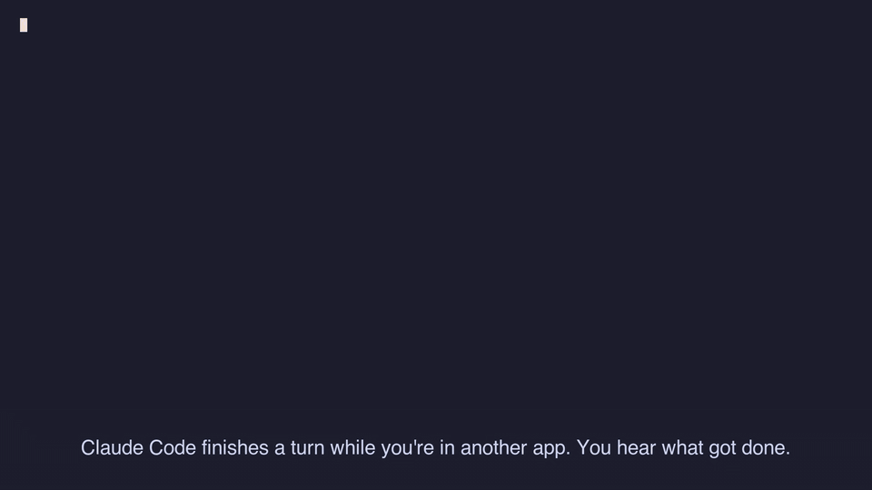

# cc-notify-tts

Claude Code tells you out loud, in one sentence, what it finished or what it needs from you, at the moments you choose, with the speech and the wording made on your Mac.



The session on screen is simulated; the hooks, daemon, wording model and voice behind it are real. `make demo` rebuilds this and the full video with sound, which also shows a permission request and a turn that stays silent while you're typing ([demo/README.md](demo/README.md)). The full video is attached to the [v0.1.0 release](https://github.com/afterimaginary/cc-notify-tts/releases/tag/v0.1.0).

## Try it

On macOS with [Homebrew](https://brew.sh) and Claude Code:

```sh
brew install uv
uv tool install --managed-python --python 3.13 git+https://github.com/afterimaginary/cc-notify-tts
~/.local/bin/cc-notify-tts setup
```

Open a new terminal, start a Claude Code session, give it a task that takes a minute and switch to another app. When the turn ends you hear what it did. [Install](#install) has the details, including the optional wording model.

## Evidence

Every number here was measured, and each links to the decision record (ADR) with its method, raw results and caveats. All were measured on 2026-11-18 on one machine, an Apple M3 Max with 48 GiB, with other work running; macOS 27.2.1 except where a row's ADR says otherwise.

### Which local model writes the sentence

The wording eval sends hand-written hook payloads (finished turns, questions and permission requests) to each model with the daemon's own prompt and guards, and checks each answer: would the daemon speak it, does it keep the detail that matters, does it claim anything wrong, and does it fit the length. A **pass** is all four. Ollama 0.40.16, the default tag of each model, temperature 0, `num_ctx` 2048. At temperature 0 the answers repeat exactly between runs, so a difference in counts is real; latency varies by about ±5% ([ADR-0016](docs/decisions/0016-wording-eval.md)).

The table is the model comparison run over the 48 cases the eval had then ([ADR-0018](docs/decisions/0018-default-wording-model.md)). The eval has since grown to 60 cases, and `granite4:micro` passes 47 of them ([ADR-0036](docs/decisions/0036-answer-only-turns.md)); the other models weren't rerun.

| Model | Digest | Pass (of 48) | Detail kept | Invented | p50 ms | p95 ms | Resident |
| --- | --- | --- | --- | --- | --- | --- | --- |
| **`granite4:micro`** (default) | `89962fcc7523` | **42** | 43 | 1 | 176 | 250 | 2.18 GiB |
| `qwen3.5:4b` | `7f3251fa6878` | **42** | 43 | 0 | 248 | 362 | 9.24 GiB |
| `phi4-mini:3.8b` | `78fad5d182a7` | 41 | **45** | 0 | 197 | 336 | 2.64 GiB |
| `llama3.2:3b` | `a80c4f17acd5` | 40 | 42 | 2 | 166 | 242 | 2.16 GiB |
| `qwen3.5:2b` | `dfaf2605162e` | 40 | 40 | 0 | 140 | 256 | 5.01 GiB |
| `gemma3:4b` | `68ceab7e468a` | 39 | 39 | 0 | 271 | 379 | 2.17 GiB |
| `gemma3:1b` | `97558784bdc9` | 36 | 37 | 1 | 84 | 162 | 0.82 GiB |
| `llama3.2:1b` | `baf6a787fdff` | 34 | 34 | 0 | 74 | 103 | 1.35 GiB |
| `qwen3:1.7b` | `8f68893c685c` | 33 | 35 | 0 | 107 | 231 | 1.13 GiB |
| `qwen3:4b` | `359d7dd4bcda` | 0 | 0 | 0 | 471 | 622 | 2.68 GiB |

`granite4:micro` is the default because it passed the most cases and its wrong answers were vague rather than harmful. `qwen3.5:4b` tied on passes but holds 9.24 GiB for as long as a session is open, and `llama3.2:3b`, two cases behind, said rows were deleted when they weren't ([ADR-0018](docs/decisions/0018-default-wording-model.md)). The full report, with every failing answer and the full digests, is [evals/results/2026-11-18-3.md](evals/results/2026-11-18-3.md). `make eval MODELS="…"` reruns it ([evals/README.md](evals/README.md)).

### How fast it speaks, and what it costs

Measured on a real session: the plugin's own hook commands, the daemon started on demand, Kokoro-82M (int8) through `kokoro-onnx` 0.6.1 and `onnxruntime` 1.32.0, Python 3.13.13, and `afplay`. 30 rounds of a prompt, a permission request and a finished turn.

| Measure | Templates | `granite4:micro` | Target | Source |
| --- | --- | --- | --- | --- |
| Hook fires → first sound, p95 | 0.74 s | 0.99 s | under 3 s | [ADR-0019](docs/decisions/0019-latency-budget.md) |
| … of which speech synthesis, p50 | 504 ms | 465 ms | | [ADR-0019](docs/decisions/0019-latency-budget.md) |
| … of which model wording, p50 | under 1 ms | 186 ms | 1 s timeout | [ADR-0019](docs/decisions/0019-latency-budget.md) |
| Hook overhead per event, p95 (slowest hook) | 58 ms | 54 ms | under 100 ms | [ADR-0019](docs/decisions/0019-latency-budget.md) |
| Hook that starts the daemon, p95 | 116 ms | same | under 100 ms | [ADR-0014](docs/decisions/0014-plugin-and-hook-shim.md) |
| Silence between back-to-back sentences, p50 | 404 ms | same | | [ADR-0022](docs/decisions/0022-afplay-playback-end.md) |
| Daemon resident memory, idle | 442–457 MiB | same | | [ADR-0019](docs/decisions/0019-latency-budget.md) |
| Model resident in Ollama while a session is open | none | 2.18 GiB | | [ADR-0018](docs/decisions/0018-default-wording-model.md) |

Hooks are async, so Claude Code doesn't wait for any of them. The one over its target is the first event after the daemon has exited (two hours without an event): that hook waits while the daemon starts. A daemon started from a hook keeps foreground scheduling priority after its session ends; a background-priority process would run only on the efficiency cores, 3.6× slower ([ADR-0002](docs/decisions/0002-on-demand-daemon-start.md)). From a clone, `uv run python -m bench.latency summarize` reads the same figures from your own `daemon.log`.

## What it says

Seven events, each worded from what Claude Code reports about it:

| Event | Example |
| - | - |
| A turn finished | "Finished up in weather app. Added exponential backoff to the forecast fetcher and two tests for the retry path." |
| Finished, with new background work still running (each item is mentioned once) | "Done for now in weather app, but background work isn't finished. Still going: audit the forecast cache and run the integration test suite." |
| That background work is all done | "Background work's all done in weather app. The integration suite finished: 112 passed, 0 failed." |
| A permission request | "Weather app needs your okay to force-push the rebased branch to main." |
| A question or a plan to approve | "Weather app has a question for you. Should the retry give up after three attempts or five?" |
| An action was denied | "Weather app was refused permission to clean build output." |
| A turn failed | "The turn failed in weather app. It hit a rate limit." |

By default each one is spoken only when you're away: no keyboard or mouse input for 20 s, or the app the session runs in out of front for 10 s. If [Ollama](https://ollama.com) is running with the wording model loaded, it may write the detail of a finished turn, a question or a permission request; otherwise the built-in wording above is used.

## Install

You need macOS, [Homebrew](https://brew.sh) and Claude Code. The three commands are in [Try it](#try-it).

`setup` links Python for the hooks, downloads the speech model (about 120 MB), installs the Claude Code plugin and, if needed, adds `~/.local/bin` to your shell's `PATH`. Open a new terminal afterwards. Running `setup` again repairs the install.

If `claude` isn't on your `PATH`, as with only the desktop app, `setup` says so and skips the plugin. Install it from Claude Code instead. On Claude Code 2.1.275 or later that's one command:

```
/plugin install cc-notify-tts --marketplace afterimaginary/cc-notify-tts
```

On earlier versions, add the marketplace first:

```
/plugin marketplace add afterimaginary/cc-notify-tts
/plugin install cc-notify-tts@cc-notify-tts
```

Then run `cc-notify-tts doctor` to check that everything a notification needs is in place. Each problem it finds comes with a fix.

### Optional: model wording

For a finished turn, a question or a permission request, a local [Ollama](https://ollama.com) model can write a shorter, more specific detail than the built-in wording. The default model is `granite4:micro`, picked by the [wording eval](#which-local-model-writes-the-sentence). With Ollama installed:

```sh
ollama pull granite4:micro
```

It's a 2.1 GB download and holds about 2.2 GiB of memory while a Claude Code session is open. Without it, the built-in wording is spoken. To use another model, set `wording.model` in the [config file](docs/specs/config.md). If Ollama runs on another port, `OLLAMA_HOST` is used as long as it points at this machine; wording never goes to another machine ([ADR-0029](docs/decisions/0029-ollama-host-on-this-machine.md)).

## Use

New Claude Code sessions are spoken automatically. Nothing needs to stay running: a small background process starts with the first event and exits after two hours without one.

**See whether it would speak now, and why:**

```
$ cc-notify-tts status
Daemon    running, pid 4242, version 0.1.0, speech ready
Mute      off
Config    ~/Library/Application Support/cc-notify-tts/config.toml (no file, so every setting is its default)
Presence  last input 2 s ago (away after 20 s); Terminal in front

Would it speak now? Sessions in Terminal: weather app
  every event      silent: you were active 2 s ago and Terminal is in front
```

**Hear a sample notification.** `fire` goes through the same when-to-speak check as a real event, so while you're typing it's usually silent and says why. `--always` skips the check:

```
$ cc-notify-tts fire permission --always
Speaking: "Weather app needs your okay to run npm test."
```

The events are `finished`, `still_running`, `background_done`, `permission`, `question`, `denied` and `failed`.

**Mute it:**

```sh
cc-notify-tts mute            # until you unmute
cc-notify-tts mute --for 30m  # or 2h, 90s, 1h30m
cc-notify-tts unmute
```

**Change when each event is spoken,** quiet hours, the presence thresholds or the voice in `~/Library/Application Support/cc-notify-tts/config.toml`. Changes apply to the next notification. See the [config reference](docs/specs/config.md).

All commands are in the [CLI reference](docs/specs/cli.md).

## Uninstall

```sh
claude plugin uninstall cc-notify-tts@cc-notify-tts
claude plugin marketplace remove cc-notify-tts
uv tool uninstall cc-notify-tts
rm -rf ~/Library/Application\ Support/cc-notify-tts ~/Library/Logs/cc-notify-tts
```

With only the desktop app, run the first two as `/plugin uninstall cc-notify-tts@cc-notify-tts` and `/plugin marketplace remove cc-notify-tts` in Claude Code. A background process still running exits on its own after its idle timeout.

## How it works

Claude Code's hooks hand each event to a small local daemon over a Unix socket. The daemon works out which of the seven events it is, checks whether to speak, writes the sentence and speaks it with [Kokoro](https://huggingface.co/hexgrad/Kokoro-82M). See [docs/ARCHITECTURE.md](docs/ARCHITECTURE.md) and the decisions in [docs/decisions/](docs/decisions/).

## How this was built

Built with Claude Code (Claude Opus 5.5), with work planned and run by Orchestral. I wrote the brief and made the design calls; a separate agent reviewed every PR, and each merged once CI passed.

The work started from a short [brief](docs/brief.md) and ran in four milestones. The first proved the risky parts before any product code: which hook events fire and with what fields, whether a daemon started from a hook survives its session at full speed, how fast Kokoro and Ollama are, and whether a hook can tell which app the session runs in. Each spike's result is a decision record. The second built a version that works on templates alone, the third added model wording, the eval and the latency measurements, and the fourth made the demo and this README.

Orchestral turned the brief into GitHub issues and ran up to three Claude Code workers at once, each on its own branch and worktree. Every PR was checked against its issue's acceptance criteria by a reviewer agent that hadn't written it, and had to pass `make verify` (ruff, strict pyright, and the unit and end-to-end tests) in CI before it merged. Every measured result and design choice is recorded in [docs/decisions/](docs/decisions/).

The run up to the v0.1.0 release, not counting the release's own issue and pull request:

| | |
| --- | --- |
| Issues | 38 filed, 27 closed as done: 24 planned from the brief, the rest raised by reviews and the acceptance run |
| Pull requests | 27 merged, each reviewed by a separate agent and merged once `verify` passed |
| Days | 1 |
| Workers | Up to 3 at once, one Claude Code session per issue |
| Tokens | About 15 M, Orchestral's estimate |
| Decisions | 23 ADRs |

## Limitations

- **macOS only.** Presence comes from CoreGraphics and `lsappinfo`, and playback from `afplay`.
- **Local downloads, local memory.** The speech model is about 120 MB, and the daemon holds about 450 MiB while it runs (it exits two hours after the last event). Model wording needs Ollama and a 2.1 GB model that holds about 2.2 GiB while a session is open.
- **Model wording can be wrong in ways the guards can't see.** The guards reject names and numbers that aren't in Claude's reply, but not a wrong claim made of the right words. The default model passes 47 of the 60 eval cases ([ADR-0036](docs/decisions/0036-answer-only-turns.md)). One wrong claim does have its own guard: when Claude's reply says tests still fail, wording that leaves that out is rejected and the template, which says so, is spoken instead. It reads English phrasing, so a failure put another way ("CI won't go green") isn't caught ([ADR-0021](docs/decisions/0021-failing-tests-never-a-success.md), [ADR-0033](docs/decisions/0033-failing-tests-phrasings.md)).
- **Measured on one Mac.** The eval and the latency budget come from one Apple M3 Max; a slower Mac will be slower. From a clone, `make eval` and `make latency` measure your own.
- **Tested in the Claude Code CLI.** The desktop app runs the same hooks, but its event coverage and closing a desktop session haven't been checked by hand ([ADR-0001](docs/decisions/0001-plugin-hook-events.md), [ADR-0002](docs/decisions/0002-on-demand-daemon-start.md)).
- **Some sessions can't be tied to an app**, such as sessions over SSH and detached tmux sessions, and iTerm2 is untested. Those always count as away, so they're spoken even while you're typing ([ADR-0006](docs/decisions/0006-presence-from-a-hook.md)).
- **A background command that runs all session holds up "background done".** A dev server is said to be still running once, but "Background work's all done" waits until it stops too, since it can't be told apart from a slow test run ([ADR-0023](docs/decisions/0023-long-running-background-work.md)).
- **English only.** The templates and the wording prompt are English.

## Roadmap

In no particular order, and without dates:

- Drop lead-ins like "Here's what was done:" from template wording ([#50](https://github.com/afterimaginary/cc-notify-tts/issues/50)).
- Try an in-process MLX model for wording, compared with the same eval.

## Contributing

See [CONTRIBUTING.md](CONTRIBUTING.md).

## License

[MIT](LICENSE)
